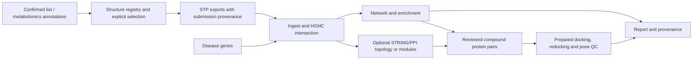

# reproducible-network-pharmacology

[](https://github.com/zym137706-ops/reproducible-network-pharmacology/actions/workflows/ci.yml)

**Reproducible network-pharmacology workflows — as a command-line tool and an agent skill.**

Turn a folder of prediction exports and a disease gene list into a **traceable, re-runnable**
compound–target–disease analysis. Every run records its inputs, reference-data versions, parameters
and hashes, and every output can be regenerated from a single config file.

> Status: **v0.1.0 release candidate, unreleased** (package version 0.1.0). The pipeline and the
> wrapper-layer exit-code guard, engine-effective gene sets and hash-checked report are implemented.
> Python is locked by `uv.lock`; R by `renv.lock`, restored in Linux CI (run 39773442191 green).
> Windows is **not verified**: an R native exit `0xC0000005` still fails 11 R-dependent tests and the
> guard is intentionally kept. The public RA case (MeSH D001172) is **locally computed** in Linux for
> 0.10 and 0.05, with independent hypergeometric/BH checks. STP confirmed on 2026-10-23 that the eight
> native XLSX tables are **CC BY 4.0** (attribution/no modification). CTD ticket **#8545** (2026-10-26)
> confirms public non-profit research including GitHub for the requested 179-gene subset/derived
> outputs, with CTD citation and a data date-stamp; commercial use is separate. A complete review
> candidate is prepared and reproduced, but **publication is pending the researcher's decision**;
> PubChem source/terms review is complete with a residual third-party caveat; final structure
> publication/visibility/release remain researcher decisions. HGNC is frozen (CC0). See
> `docs/stp-permission-2026-10-23.md`, `docs/ctd-permission-2026-10-26.md`, and
> `docs/public-candidate-reproduction-2026-10-27.md`.
> The thin Skill has a final-revision Codex real-agent acceptance (normal/missing/partial/tamper/zero;
> Linux enrichment/report via Docker; one shell-wrapper caveat) plus a separate DSH session; see
> `docs/skill-acceptance.md` and `docs/skill-agent-acceptance-2026-10-21.md`. This is not a general
> validation. The latest portable-entry clean-clone run is recorded in
> `docs/case-entry-clean-run-2026-10-22.md`; the earlier run remains historical at
> `docs/case-clean-run-2026-10-21.md`. See the
> [maintained plan](docs/project-plan.zh-CN.md),
> [case freeze](examples/demo/CASE-FREEZE.yaml),
> [public-case sources](docs/public-case-sources.md), [data access](examples/demo/DATA-ACCESS.md) and
> [environment record](docs/environment.md).

---

## Why this exists

Network-pharmacology analyses are usually assembled by hand: click SwissTargetPrediction, download
a spreadsheet, copy gene symbols into Venn diagrams, run enrichment on a website. The result is
hard to reproduce because the things that decide the answer are never written down — the probability
threshold, the gene-symbol mapping, the database release, the exact input files.

This project makes those decisions explicit:

- **Deterministic core.** Parsing, gene-symbol normalization, set intersection, network tables and
  enrichment are code, not manual steps.
- **Provenance by default.** Each run writes `run_manifest.json`: tool version, git commit, input
  hashes, reference-data versions, parameters, timestamps.
- **Explicit failure.** Known data traps raise actionable errors instead of being silently skipped.
- **Agent layer on top, not inside.** The CLI is the source of truth; the skill only orchestrates,
  asks for human decisions and explains results. You can use the CLI without any agent.

## Pipeline

The diagram includes planned capabilities; the command table distinguishes current implementations.



## Quickstart

```bash
# Python 3.10+ and R 4.5.x (R only needed for the enrichment step)
uv sync --locked --extra dev

# restore the R lock and use the exact absolute library it prints
bash scripts/restore_r.sh
export R_LIBS="<the R_LIBS path printed above>"

# 1. check the quickstart config against the JSON Schema
uv run rnp validate --config examples/quickstart/run.yaml

# 2. bind compounds to exports and parse them into one audited table
#    (writes results/quickstart/ and results/registry/compound_registry.tsv)
uv run rnp ingest stp --config examples/quickstart/run.yaml --run-id quickstart

# 3. map genes, intersect with the disease set, and write Cytoscape tables
uv run rnp intersect --config examples/quickstart/run.yaml \
  --targets results/quickstart/targets.tsv
uv run rnp network --config examples/quickstart/run.yaml \
  --intersect results/quickstart/intersect

# 4. enrich with an explicit background (Rscript required)
uv run rnp enrich --config examples/quickstart/run.yaml \
  --intersect results/quickstart/intersect

# 5. render a Markdown report from the verified stage audits
uv run rnp report --config examples/quickstart/run.yaml \
  --run-dir results/quickstart

# 6. verify provenance
uv run rnp manifest --run-dir results/quickstart --check-inputs

# 7. offline synthetic demo: 5 scenarios with hand-computed expected tables
uv run python scripts/synthetic_demo.py --out .demo

# 8. tests
uv run pytest -q
```

The self-contained fixture is used for the quickstart and by the test suite. Each command refuses to
overwrite an existing output directory unless `--force` is passed. Downstream commands refuse an
incomplete upstream stage unless `--allow-partial` is passed, and the override is recorded in the
audit. Ingest creates a persistent compound-ID registry; a re-run reuses the same IDs.

The public-data RA case (`examples/demo/`) is **locally computed, independently checked, and
reproduced from a clean clone**. STP's eight native tables are **CC BY 4.0-confirmed** with
attribution/no-modification requirements; CTD ticket **#8545** confirms the requested **public
non-profit research** use (including GitHub) with CTD citation and a data date-stamp. PubChem
source/terms/citation review is complete with a residual third-party-rights caveat. The complete
candidate is prepared outside Git, but **publication is pending the researcher's decision** on final
file inclusion, visibility and release. Its data access/reproduction guide is
[examples/demo/DATA-ACCESS.md](examples/demo/DATA-ACCESS.md); data/license checklist is in
[docs/public-case-checklist.md](docs/public-case-checklist.md); STP exports are produced by hand.
The synthetic demo is an engineering test, not a scientific result.

For a user-supplied real case, [`scripts/case_run.py`](scripts/case_run.py) verifies explicit
bindings/hashes and exact submitted structures when a log is supplied, fixes both threshold configs,
runs the full CLI chain, invokes [`scripts/case_check.py`](scripts/case_check.py) and records
`case_provenance.json`; the overall status is `complete` only after the analysis, both manifest checks
and the independent set/p-value/BH check succeed. Source hashes use the versioned
`case-source-hash-v2` scope (case-relevant source + entrypoints + locks, not the whole package).
See [docs/case-run.md](docs/case-run.md). This is an orchestrator only: business logic remains in `rnp`.

Windows note: make sure `python` resolves to Python 3. A common trap on workstations with
molecular-modeling tools installed is `python` resolving to **MGLTools' Python 2.7**; use `py -3.12`
or `uv run` explicitly. See [docs/limitations.md](docs/limitations.md).

## Commands

| Command | Status | What it does |
|---|---|---|
| `rnp validate` | ✅ | Validate a run config and every declared input path |
| `rnp ingest stp` | ✅ | Bind compounds to exports, parse xlsx/csv (merged title rows, multi-symbol targets, complexes) into `targets.tsv`; quarantine unbound exports; classify file status; stage status |
| `rnp manifest` | ✅ | Validate a run manifest and detect drift in recorded input hashes |
| `rnp intersect` | ✅ | HGNC-normalized intersection; refuses partial upstream by default; exclusions and conflicts in audit tables |
| `rnp network` | ✅ | Cytoscape node/edge/MOLlist tables + Venny data; optional R Venn plot (`--venn-plot`); valid empty network for zero hits |
| `rnp enrich` | ✅ | ORA via R `clusterProfiler` per group with an **explicit background**; complete tested-term table + significant view; distinct statuses for no-hit vs failure |
| `rnp mcode` | 🚧 later extension | Module enrichment from Cytoscape MCODE exports; independent of hub ranking |
| `rnp report` | ✅ | Markdown report from verified stage audits + tables; hash-checked; no claims beyond the evidence |
| `scripts/case_run.py` | ✅ local case entry | Portable preflight + full CLI chain for user-supplied inputs; records source/config/container provenance |
| `scripts/case_check.py` | ✅ independent check | Re-derives T_r/foreground and recomputes hypergeometric/BH from result tables |
| `rnp metabolites import` | 🚧 v0.2 | Import processed metabolomics annotations; confirmed compound lists also supported |
| `rnp structures resolve` | 🚧 v0.2.0 | Resolve names / InChIKeys to structures (PubChem cache) |
| `rnp compounds annotate/select` | 🚧 v0.2 design | Properties plus explicit inclusion/exclusion decisions; all original candidates retained |
| `rnp hubs compute` | 🚧 later extension | Centrality/rank aggregation; not a replacement for MCODE |
| `rnp dock prepare/run/qc` | 🚧 v0.3 design | Suitable co-crystal systems and ordinary noncovalent small molecules, controls and pose QC |

## Input contracts

| Input | Format | Required content | Notes |
|---|---|---|---|
| `inputs.compounds` | TSV/CSV | `name`; optional `compound_id`, `group`, `stp_file`, `submission_id`, `smiles`, `source` | Explicit `stp_file` is required unless `inputs.allow_filename_match: true` (a recorded compatibility mode); duplicate names/files are errors |
| `inputs.compound_registry` | TSV (optional) | persistent `compound_id` registry | Defaults to `<outputs.dir>/registry/compound_registry.tsv`; created on first run and reused afterwards |
| `inputs.stp_dir` | directory of `.csv` / `.xlsx` | STP export header somewhere in the first 10 rows | Exports not bound to a compound are quarantined, never turned into edges |
| `inputs.disease_genes` | one symbol per line, or TSV with `gene` | Gene symbols | Unresolved symbols abort the run; source and retrieval date live in the config |
| `inputs.hgnc_map` | HGNC complete-set TSV | `hgnc_id,symbol,status,prev_symbol,alias_symbol,uniprot_ids,entrez_id,locus_group` | Only `Approved` records are indexed; aliases split on `|` |
| `inputs.mcode_dir` | directory of MCODE CSVs | `name` column + cluster/score columns | Column suffixes such as `MCODE::Clusters (1)` are tolerated |

## Known failure modes (and what the tool does)

| Symptom | Likely cause | Tool response |
|---|---|---|
| Header not found | xlsx merged title row / wrong export | Scans first 10 rows; raises `InputError` listing the columns it saw |
| `common name = N/A` | composite / multi-protein target | Kept as a warning; never split into individual genes |
| `common name = "CDK5R1 CDK5"` | multiple symbols in one cell | Flagged `multi_symbol_common_name`, excluded from single-gene main table |
| Probability not numeric / out of 0–1 | localized decimal comma, corrupted export | Row counted as `rows_invalid` (never as below-threshold); file status becomes `partial` or `invalid_rows` |
| Empty result table | structurally valid export with no rows | `no_predictions`; a valid empty result, not a success with edges |
| All valid predictions below threshold | threshold too strict / weak predictions | `below_threshold`; stage still complete, zero edges |
| Export not listed in the compound table | stale or extra file | Quarantined with a reason; excluded from `targets.tsv` |
| Compound bound to a missing export | deletion / rename | Stage `partial`, exit 3, `missing_exports` recorded |
| Downstream sees a partial stage | incomplete ingest | Refused with exit 2 unless `--allow-partial`; override recorded in audit |
| Output directory already exists | repeated run | Refused; pass `--force` to replace (recorded) |
| Gene symbol not in HGNC | retired symbol, alias, species mismatch | Listed in `gene_mapping_conflicts.tsv`; mapped only when unique |
| Symbol resolves to two genes (shared alias) | ambiguous alias | Left unmapped with `ambiguous_symbols` listed; never guessed |
| Compound name equals a gene symbol | node collision in Cytoscape | `rnp network` exits with code 2 instead of silently merging nodes |

## Human-review gates

Review gates are design requirements, not a claim that an interactive gate engine is implemented.
Use already recorded researcher decisions; request only missing or conflicting scientific choices.
Upstream identity/selection and docking controls extend the core gates. See [review-gates](docs/review-gates.md).

## Reproducibility

Implemented in this slice:

1. Compound↔export binding and quarantine, so an unbound file cannot silently become an edge.
2. Stage status (`complete` / `partial` / `empty` / `partial_override`) and parent audit/hash links;
   downstream stages refuse incomplete upstream runs unless an override is recorded.
3. Separate **code identity** (this repository's version/commit) and **config identity** (config path,
   SHA-256, and the config repository's state).
4. Stable `compound_id` via a persistent registry; explicit IDs are reserved before automatic
   assignment, persisted, and conflicting reassignment is refused.
5. Full-precision probabilities in machine-readable tables; presentation rounding is separate.
6. An offline synthetic demo with hand-computed expectations and failure scenarios.
7. `rnp report` re-verifies every artifact it reads (targets, compounds, edges, intersection,
   disease, exclusions, conflicts, Venn data, enrichment views, universe) and the parent-stage audit
   hashes before rendering; missing stages are "not run" and partial stages need an override.
8. Python dependencies are locked (`uv.lock`, `uv sync --locked`); R dependencies are locked by
   `renv.lock` and CI restores that lock (observed versions are also recorded per run).
9. A non-zero R process status is never masked by a plausible meta file; engine-effective
   foreground/background sets are written with hashes and counts.

Still required before calling v0.1.0 released:

- researcher approval of the complete public-case candidate, final file inclusion,
  repository visibility and versioned release (checklist in
  [docs/public-case-checklist.md](docs/public-case-checklist.md));
- the final `v0.1.0` tag/release created only after that approval; a green CI run is not a release.

See [architecture](docs/architecture.md) for current gaps and target contracts.

## Scope and limitations

This project analyzes **predicted** compound–target associations and **computes** enrichment. It
does not predict binding or claim mechanism or efficacy. Docking is an optional later module
(v0.3 design); initial support is limited to suitable co-crystal systems and ordinary noncovalent
small molecules. Redocking recovery, pose plausibility and screening discrimination are separate assessments.
A network edge means “this compound was predicted to hit this target, and this target is annotated
to this disease” — nothing more. See [docs/limitations.md](docs/limitations.md).

Restricted databases (GeneCards, OMIM, KEGG) are **never redistributed**. The tool ships download
instructions and an adapter; users obtain the data under their own license. See
[docs/data-licenses.md](docs/data-licenses.md).

## Roadmap

| Release | Scope | State |
|---|---|---|
| v0.0.1 | Scaffold: package, schemas, CLI, tests, CI, docs | ✅ done |
| **v0.1.0** | Core hardening; `enrich`; `report`; Skill; public-case candidate reproduced | release candidate, not published |
| v0.2 | Confirmed lists / metabolomics → structure registry → annotation → explicit selection | planned |
| v0.3 | Minimal docking: reviewed pairs, preparation, controls, redocking and pose QC | planned |
| Later | PPI topology/RRA, MCODE, predicted receptors and historical batch migration | independently scoped |
| v1.0 | Stable contracts, declared compatibility and reproducible cases | evidence-gated |

Ship the verifiable core before extensions. Schema changes require explicit versioned migration;
a roadmap, video or DOI is not evidence that a capability works. Detailed designs:
[upstream](docs/upstream.md), [docking](docs/docking.md), [ADR-0004](docs/adr/0004-staged-upstream-and-docking.md).

## 中文摘要

本项目把网络药理学的「成分 → 靶点 → 疾病 → 通路」分析，从手工点网站变成可校验、可复现的
命令行工具 + Agent 技能层。核心设计：**CLI 是唯一事实来源**（不用 Agent 也能跑），每个子命令
校验输入、显式报错、写审计文件；每次运行生成带哈希与版本信息的 `run_manifest.json`；公开数据
demo 将用可独立核验的预期结果守住数值；受限数据库不再分发。当前是 v0.1.0 发布候选、
尚未正式发布（包版本 0.1.0），新增设计不代表命令已实现。完整中文说明见 [README.zh-CN.md](README.zh-CN.md)。

## License

Code: MIT. Reference data keeps its own license — see [docs/data-licenses.md](docs/data-licenses.md).
